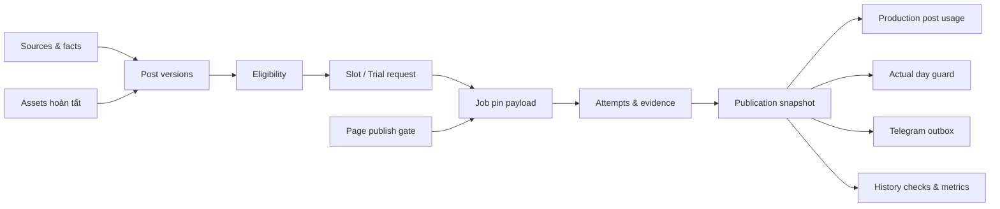

# Thiết kế trước code — hệ thống fanpage Ngành Kinh tế số

Tiến độ 05/10/2026: bước 1–5 đã xây backend và workflow giả lập local, TypeScript và 116 test đạt; chờ phê duyệt bước 6. Kho có 40 đề cương nháp, 0 bài đủ điều kiện. Theo TIEN-DO-TRIEN-KHAI.md và docs/steps/05-local-workflow.md. Nội dung thiết kế v4.3 bên dưới giữ làm hợp đồng và ghi nhận mốc trước code; không đồng nghĩa các tính năng còn lại đã triển khai.

Đính chính phạm vi 05/10/2026: một bài/ngày là giới hạn của luồng tự động, không phải tổng số bài trên Facebook. Bài admin đăng trực tiếp không tiêu slot/usage, không mở incident đăng trùng và không chặn lịch tự động. Không cần skip/pause chỉ vì có bài thủ công bổ sung.

Ngày lập: 04/10/2026; cập nhật: 05/10/2026. Phiên bản 4.3, đi cùng KE-HOACH-TONG-THE.md v4.3 và NGHIEM-THU-CHAY-THU.md; tích hợp đánh giá v4.2, giữ bài thủ công độc lập. Bộ thiết kế đủ bắt đầu code chạy thử local, chưa viết ứng dụng hoặc kiểm thử đạt. Bảng chuyển trạng thái mục 18 kế hoạch là hợp đồng chính; cổng A/B/C mục 20 phân biệt local, live staging và production. Không có token, mật khẩu hay tài khoản dịch vụ được tạo trong tài liệu này.

## 1. Phạm vi và thuật ngữ

Một chủ tài khoản, một fanpage chính thức; staging dùng fanpage thử riêng. GUI Google allowlist, biên tập/import kho, dựng ảnh tại browser, lịch, publish/retry/reserve, đối chiếu, lịch sử, Telegram, metric thủ công, monitor và backup. AI runtime, tái đăng lịch sử, auto sinh bài, nhiều quản trị viên, video, trả lời bình luận/inbox và Insights tự động ngoài bản đầu.

Post là danh tính nội dung; version là bản nội dung/ảnh/facts cụ thể; slot là một ngày đăng dự kiến; job là ứng viên được giữ cho slot hoặc yêu cầu thử; attempt là một lần gửi được ghi nhận; publication là bằng chứng xuất bản trên đích; incident là sự cố với phạm vi; eligibility là điều kiện chọn một bản tại một thời điểm. “Sẵn sàng” không có nghĩa đã đăng. Ngày dự kiến khác ngày xuất bản remote và ngày nhận phản hồi.

## 2. Schema logic và ràng buộc

Các timestamps lưu UTC, ngày nghiệp vụ tính Asia/Ho_Chi_Minh. ID không chứa secret. Metadata có schema/version, không dùng JSON không kiểm tra thay cho ràng buộc nghiệp vụ.

| Thực thể | Trường chính | Ràng buộc/index cần có |
|---|---|---|
| posts | id, content_key, group, pool, current_version_id, created_at | content_key duy nhất trong đợt; pool không thay lịch sử đã dùng |
| post_versions | id, post_id, version, body, caption_title, image_headline/points/description, audience, concept/angle/level/outcome, source/fact_refs, asset_id, template/renderer/font_version, review_due_at, check_version, status | unique(post_id,version); index status/group/audience; asset/facts/check hợp lệ để ready; version pin bất biến |
| assets | id, key, checksum, content_type, width/height, size, status, created_at | key/checksum, final key không ghi đè; ready ảnh vuông; key thuộc bucket đúng môi trường |
| sources | id, version/hash, title, path/key, reviewed_at, review_due_at, status | nguồn được tham chiếu phải tồn tại; PDF nhận không tự thành verified |
| program_facts | id/key, version, value, cohort, authority/source, confirmed_at, status | unique(key,version); duration hiện hành 3.5, cohort2026, user_confirmation |
| fact_references | post_version_id, fact_id/version, claim | index fact/version để invalidation; không cập nhật snapshot lịch sử |
| page_connections | id, environment, page_id/name, config_version, health | environment/page duy nhất; credentials nằm secret store, không ở dữ liệu thường |
| schedule_slots | id, page_id, business_date, planned_post, status, skip_reason, publication_id | unique(page_id,business_date) production; index date/status; skip không tự fill |
| publish_jobs | id, slot_id/request_id, page/environment, version/payload/asset/footer snapshot, state, next_attempt_at, attempt_count, owner/generation/lease, requested_at | request_id duy nhất cho trial; chỉ một job hoạt động được phép gửi/slot; index state/next_attempt; generation CAS |
| page_publish_gates | environment, page_id, active_job_id, generation, state, held_at | unique(environment,page_id); claim/intent nguyên tử; requested/unknown chặn mọi job khác trên page, không release vì lease hết hạn |
| attempts | id, job_id, ordinal, stage, start/end, outcome, error_class, evidence | unique(job_id,ordinal); record trước publish; không reset lịch sử |
| publish_evidence (có thể thuộc attempts) | id, job/attempt/request_id, environment/page_id, remote_id, observed_at, remote_time, outcome, normalized_payload/hash, state pending/applied/conflict, processing_generation, next_at, last_error | idempotent theo event/remote identity; intake trước finalization; index state/next_at; finalizer có quyền hiện hành, không cần ownership cũ để thu bằng chứng |
| publications | id, job_id, page_id, remote_id/link, snapshot, scheduled_date, requested_at, confirmed_at, remote_published_at/date/evidence, visibility | unique(page_id,remote_id); index job/actual date; nhiều remote ID cùng job là incident nhưng vẫn giữ sự thật; immutable snapshot |
| production_post_usage | environment, page_id, post_id, first_publication_id, used_at | unique(environment,page_id,post_id); chỉ production; version khác chung post_id không trở thành ứng viên mới; không bỏ evidence/publication thật khi conflict |
| actual_day_guards | page_id, remote_business_date, publication_id, state | unique(page_id,date) cho publication do hệ thống gửi; bài thủ công trực tiếp không tạo guard; thêm publication của hệ thống là incident, không bỏ evidence |
| notification_outbox | event_id, publication/incident_id, payload, state, tries, next_at, delivered_at, message_id, last_error, delivery_unknown_since | event_id duy nhất; index state/next_at; delivered khi phản hồi Telegram hợp lệ; không có idempotency remote mặc định, không gọi lại Facebook |
| incidents | id, scope_type/id, class, opened_at, last_alert_at, state, evidence | gộp sự cố tương đương đang mở; không gộp mất thông báo thành công riêng từng bài |
| application_state | environment, paused_by_user, blocked_reasons, maintenance owner/reason/generation, operation_generation, schedule_start, last_run/success, finalization_progress | quyền môi trường phối hợp maintenance/intent nguyên tử; reason tách biệt; không auto enable theo deploy/lease |
| imports / backups / audit / checks / metrics | batch/schema/checksum/state; backup phase/export_owner/snapshot/manifest/asset_pin; actor/action/time; observation/source/value | import idempotent; export_finished khác backup_complete; metrics có thời điểm quan sát; backup pin assets tới complete/fail |

Schedule/job/attempt/publication không gộp vào một status của posts. Body metadata có thể lưu JSON, những khóa/unique/lượt publish bắt buộc ở D1. Không bật read replication trước khi cần; claim và xác nhận dùng trạng thái authoritative của D1.



### Claim, mạng và commit

1. Evaluate eligibility theo post_id/usage, version/checks/asset/facts; giao dịch claim có điều kiện giữ slot/ứng viên và page gate, tạo job/payload và owner generation. Hai slot hoặc hai trial request không cùng gửi trên một page; trial vẫn có thể tuần tự nhiều lượt.
2. Kiểm tra pause/block/maintenance/owner/day/page gate và cấp quyền môi trường cùng ghi publish intent/attempt trong một giao dịch có điều kiện. Backup begin tranh cùng quyền này: backup thắng thì intent bị chặn; intent thắng thì backup deferred. Không check-then-set rời hoặc giữ transaction qua network. Gate giữ khi request đang bay/unknown; verified failure có thể release an toàn, nhưng retry vẫn claim lại quyền khi đến hạn.
3. Adapter phân loại bằng chứng: confirmed, verified_failed_retryable, verified_failed_final hoặc unknown. Upload stage không xác nhận publication.
4. Tiếp nhận normalized evidence idempotent bằng thao tác lưu riêng trước giao dịch finalization. Khi confirmed, tiến trình có quyền hiện hành ghi publication/slot/day guard/usage/outbox theo trạng thái. Worker mất lease không ghi đè lịch nhưng kết quả request cũ vẫn được intake để đối chiếu. Conflict actual-day/usage hoặc thêm remote ID không rollback evidence: ghi publication thật/incident theo đường xử lý conflict và giữ block, không coi đó là một lượt gửi được cho phép.
5. Crash từ intent đến commit chuyển unknown, không dùng lease expiry để gửi lại. UNIQUE/CAS phải thất bại an toàn; zero-row update không được coi là giữ lượt thành công. Nếu storage không nhận được evidence, intent/unknown cùng đối chiếu remote là đường phục hồi; không bảo đảm lưu phản hồi khi storage mất khả dụng, không exactly-once.

Scheduler xử lý evidence pending/finalizer và reconciliation đến hạn theo lô giới hạn trước publish mới trên page. Evidence confirmed đủ căn cứ được tự apply publication/usage/outbox theo bảng mục 18, không bắt owner xác nhận lại và không gửi lại Facebook. Một batch finalization thất bại để evidence pending/next_at/last_error; retry nội bộ idempotent. Conflict giữ block, evidence không đủ giữ unknown. Health trả số/tuổi pending và thời điểm tiến độ ngoài heartbeat; cron chạy không đồng nghĩa đã xử lý được công việc. SQL phải chặn ghi phụ sai khi claim UPDATE 0 dòng, không đợi đọc batch result rồi mới sửa.

Khi đổi version, asset, facts hoặc footer, lượt mới chỉ dùng bản đủ checks. Block của bản đã biết sai áp dụng cả retry chưa gửi; request đang bay giữ evidence/đối chiếu. Tạo assets theo key mới; dọn orphan trì hoãn và có bảo vệ tham chiếu publication/ready/backup.

## 3. Hợp đồng API logic

Prefix /api, JSON UTF-8, schema_version rõ; thời gian ISO8601 UTC. Owner session cookie an toàn; xác minh Google OIDC và email tranthanhtung37@gmail.com phía server. Mọi mutation bảo vệ CSRF/origin thích hợp. Service monitor/backup dùng credential scoped riêng, không có quyền posts/publish/settings. Page ID/environment lấy từ config server, không tin đích do client tùy gửi.

| Nhóm route | Request / Response chính | Quyền / tính chất |
|---|---|---|
| auth/login, callback, session, logout | OIDC state/nonce, session/current owner | Luồng OIDC; callback không tin email do client |
| facts, sources | List/detail; update có expected_version, value, authority | Owner; trả danh sách version bị ảnh hưởng, audit |
| posts, posts/{id}/versions | Query filters/cursor; body/metadata/checks, expected_version | Owner; không ghi đè pin; conflict trả409 |
| assets/uploads, assets/finalize | Metadata, file/key/checksum; asset status | Owner; giới hạn loại/kích thước; finalize sau kiểm chứng |
| imports/preview, imports/commit | batch_id, content_key/version, rows; errors/counts | Owner; commit theo preview/version; nhập lặp trả kết quả trước |
| stock, schedule | Eligibility reason/counts; slots, date, expected_version | Owner; skip/day và remove-post phân biệt |
| publishing/pause, resume | reason, start_date; application_state | Owner; không auto clear block/unknown, không catchup ngày bỏ |
| trial-publish | request_id, post_version; job_id/state | Owner; chỉ fanpage thử cấu hình; idempotent cùng request |
| jobs, jobs/{id}/reconcile | Evidence, action, verified remote URL/ID hoặc failure basis | Owner; server kiểm tra, không nút force-reset unknown |
| publications, history/checks | Snapshot/link/availability/checktime | Owner; snapshot read-only, không recycle |
| metrics, editorial-notes | Observed_at, source, defined values/reason | Owner; không sửa history payload |
| settings/connections | Metadata/status/test action | Owner; secrets qua luồng thiết lập server, output luôn redacted |
| backups/export, restore/preview/commit | Manifest/schema/checksums; restore report | Owner hoặc service export scope; restore owner, mặc định quarantine |
| backups/begin, status, finish | backup_id/owner, maintenance reason/state, export result | Owner hoặc backup scope; chỉ maintenance của backup, không đổi pause/block/đích; finish kiểm chứng export kết thúc |
| health-monitor | Minimal heartbeat/version/reasons/backup age | Monitor read-only; không có caption/secret, không quyền mutation |

Mọi thao tác có rủi ro lặp dùng Idempotency-Key/request_id; key gắn owner/env/action và hash input. Cùng key khác input trả409, không âm thầm làm lần mới. Response mutation không đồng nghĩa remote success: trả resource ID/state và dùng status theo dõi.

Error contract: code, message tiếng Việt an toàn, request_id, retryable, reason_codes, field_errors nếu validation; không stack/token/raw response nhạy cảm. Các lớp:401/403 quyền;409 conflict;422 invalid/eligibility;429 hạn mức;503 dịch vụ. Mã HTTP chỉ hỗ trợ UI; adapter quyết định publish outcome dựa giai đoạn/evidence, không retry mọi503 nếu đã gửi.

Giới hạn đầu: một ảnh PNG1080 vuông/bài, tối đa5MB upload final; file lớn giữ draft và yêu cầu tối ưu, không tự làm giảm chất lượng logo. Import chia lô40 bài, không nhét ảnh base64 vào JSON đợt. Export/backup chia phần theo manifest. Caption length/định dạng API được adapter kiểm chứng theo Graph version trước ready, không tự cắt footer/body để vượt giới hạn.

Backup begin trả acquired/deferred và owner/generation/phase; acquired chỉ sau quyền môi trường nguyên tử không có request đang bay. Status phân biệt export_maintenance, database_export_finished, assets_copying, package_uploading, complete/failed. Finish tách kết thúc export maintenance khỏi complete gói, kiểm chứng DB/export đúng owner; không gỡ pause/block/unknown hoặc dùng lease cũ làm quyền. Health bổ sung pending_evidence_count/oldest_age/finalizer_last_progress, overdue_outbox và operation/backup phase; chỉ metadata, không tạo quyền mutation cho monitor.

## 4. Wireframe và design spec

### Khung giao diện

```text
[Tên fanpage] [STAGING/PRODUCTION] [Release] [Lịch: bật/dừng] [Tạm dừng]
Tổng quan | Kho bài | Lịch | Lịch sử | Cài đặt
Bài lỗi/Đối chiếu và Kết quả: mở từ ngữ cảnh/điều hướng phụ

TỔNG QUAN
Trạng thái: đang hoạt động / paused / connection-blocked / unknown / empty
Lượt tiếp theo: ngày, 10h VN, tiêu đề, version và fanpage
Kho: tổng bản ghi / bài gốc dùng được / số ngày còn phủ
Kho hợp lệ: chính / reserve / theo nhóm | Cảnh báo nguồn/ảnh
Scheduler gần nhất | Telegram pending | Monitor | Backup complete gần nhất
[Xem lượt] [Xử lý sự cố] [Bổ sung kho]
```

```text
CHỈNH SỬA
Trái: caption title / body / đối tượng / nhóm
Mở rộng khi cần: nguồn & facts / góc / mức độ / phiên bản / rubric
Phải: preview ảnh1080, image_headline, points, description, mẫu/màu/minh họa
Dưới: preview caption + footer đầy đủ, eligibility reasons, version đang pin
[Lưu nháp] [Dựng ảnh] [Kiểm tra & đưa sẵn sàng] [Phục hồi version hoàn tất]
```

```text
ĐỐI CHIẾU UNKNOWN
Job + fanpage + ngày dự kiến / request time / bằng chứng remote time
Caption/PNG đã pin | Attempts và evidence đã loại secrets
[Nhập link/ID để kiểm tra] [Ghi căn cứ chưa xuất bản] [Giữ chờ]
Thông báo: không tìm thấy caption chưa chứng minh chưa đăng.
Không có nút gửi lại trước khi kết luận đủ căn cứ.
```

Lịch phân biệt chưa xếp, planned, held/requested, confirmed, skipped, expired, replaced_by_late_publication và unknown. Bài lỗi sửa xong về reserve, không có nút tự publish production. Trial button luôn thể hiện fanpage thử. History đọc snapshot, notes/metrics nằm riêng. Cài đặt có preview đích, timezone, footer/version, status secret và maintenance; mọi thay đổi đích xử lý jobs theo kế hoạch.

### Mẫu ảnh

| Mẫu đầu | Cấu trúc | Nội dung thử |
|---|---|---|
| Checklist | Dải logo → headline →3–4 ý ngắn → dấu minh họa | P02, tràn chữ/dấu tiếng Việt |
| Quy trình/so sánh | Dải logo →headline →steps/vế có quan hệ | P06 hoặc ví dụ dashboard/brief |
| Tình huống ít chữ | Dải logo →headline →minh họa chủ đạo | P04/P05/P08 |

1080×1080, logoTrường→Khoa→Ngành nguyên màu/tỷ lệ, không thêm dòng tên ngành. Thông số thử logo band160–190px, title64–80px/body36–44px/margin48–64px là baseline; mobile QA quyết định chốt, không tuyên bố quy chuẩn thương hiệu. Màu linh hoạt trong phối màu dễ đọc. Title ảnh ngắn; tràn phải rút/đổi mẫu; font/ảnh chưa tải chặn finalize. Bản final PNG và checksum là artifact đăng, không render vào cron.

Năm caption/ảnh mẫu được sản xuất sau cổng kế hoạch trong chặng mẫu; trước code đã chốt brief/luồng/design spec, chưa tự coi ảnh chưa tạo là đã đạt mobile QA.

## 5. Test plan và cổng nghiệm thu

36 tình huống đầy đủ ở mục11 kế hoạch. Nhóm và bằng chứng:

| Test IDs | Nhóm | Expected result / bằng chứng |
|---|---|---|
| 1,11,13,16,27 | Publish/đích/release | Fanpage/ID/link/version đúng; trial tách; job cũ không chuyển đích; CI/SHA khớp |
| 2,14,15,24,25 | Tranh chấp/crash/D1/R2 | Không có request mới từ owner cũ; zero-row không claim; crash thành unknown khi cần; asset lịch sử giữ |
| 3–7,29,32 | Retry/API/outbox | 3 lần tổng cộng/5 phút cho lỗi đủ điều kiện; ID ảnh chưa confirmed; timeout không repost; lỗi chung không tiêu hao kho |
| 8,18,23,33 | Stock/reserve/skip | Eligibility thống nhất; ưu tiên đúng; skip không fill; cảnh báo/reset đúng |
| 9 | History | Unavailable khác unverified; caption/PNG còn; không có thông báo xóa riêng |
| 10,17,21,22,31 | Edit/pause/facts | Bản mới chưa ảnh không ready; pin giữ; chặn bản đã biết sai; pause không thu hồi yêu cầu đã gửi |
| 12 | Auth/secrets | Email khác bị server từ chối; CSRF/OIDC checks; secret không xuất hiện ở output |
| 19,26,28,34,36 | Import/release/restore | Không reset retry/enabled; snapshot không đổi; restore quarantine, checksum/keys đủ, không đăng đích thật |
| 20,35 | CPU/monitor | Benchmark CPU/memory/quotas; website200 nhưng heartbeat stale vẫn báo qua monitor |
| 30 | Qua ngày | Ngày remote khác ngày nhận xác nhận; guard chặn ngày thực tế, không đăng dồn |

Test giả lập dùng clock/network adapter fake để kiểm soát sự cố. Live test fanpage thử kiểm chứng quyền, luồng một ảnh, evidence/time, caption/logo/footer, Telegram và lịch khi PC tắt. Số lần live và quyền kiểm chứng ghi trong kết quả; mock không chứng minh quyền Meta production. Performance test dùng 40 bài và history giả lập lớn, upload5MB, export nhiều PNG, login/similarity/outbox; đạt giới hạn cấu hình có dư và không mất kiểm soát nghiệp vụ.

### Định dạng backup và runbook

Chọn age cho mã hóa public-key; gói tar/manifest gồm schema_version, snapshot_time, deployment, datasets, asset list/checksums và completeness. Recipient public key dùng CI; identity private key do chủ tài khoản giữ ngoài CI/repo/Cloudflare. Công cụ age hỗ trợ mô hình này theo [tài liệu chính thức](https://age-encryption.org/). Không nhập private key vào trò chuyện. Giải thích việc giữ khóa trong setup và diễn tập giải mã → verify → restore staging quarantine → đối chiếu remote → chọn mốc bật lại. Sao lưu hằng ngày04:20VN, giữ tối thiểu3 bản hoàn tất trong ngân sách kiểm chứng; bản trước migration giữ đến nghiệm thu. Quá quota là điều kiện chặn triển khai/sự cố cần báo, không phải lý do bỏ backup.

Runbook gồm: outage Meta (dừng, không tiêu reserve), unknown (evidence, không force), Telegram (retry tin), asset/fact (block phạm vi), scheduler (monitor ngoài), empty (import valid → chọn start → resume), release (CI/SHA → backup → migration → deploy → smoke không publish), restore (default pause → verify → reconcile → resume). Có test chủ tài khoản tìm, đọc và giải mã được backup.

## 6. Trạng thái và phụ thuộc

Thiết kế scope/schema logic/transition/API/wireframe/test/runbook đã được lập trong bộ tài liệu trước code. SQL/index cụ thể, SDK/Graph version, integration và pixel/render là công việc triển khai; phải tuân thủ ràng buộc thiết kế, ghi ADR khi bằng chứng buộc thay. Chưa có kết quả live/performance, chưa đủ40 caption/PNG và chưa có credentials.

Trước triển khai cần: kết nối GitHub của người dùng và tạo repo riêng; Cloudflare/quota R2; Google OAuth redirect; Meta app/quyền/page thử; Telegram bot/chat ID; age keys và tổng quota Actions/artifacts. Không cần Page ID chính thức/ngày bắt đầu trước code. Nếu Meta không hỗ trợ evidence đủ, giữ unknown/manual resolution; không tháo chặn để giấu hạn chế. Nếu miễn phí không đạt, trình lựa chọn trước production. Không tự mua gói.

Reader test kiểm tra sự nhất quán của thiết kế; không phải app test. Sau khi người dùng xem bộ kế hoạch hoàn chỉnh, mới chuyển sang bước triển khai khi có yêu cầu tiếp tục xây dựng.

## 7. Hợp đồng bổ sung v4.1 và thứ tự nghiệm thu

- Checks lưu rubric năm tiêu chí ở mục 2 kế hoạch cùng reviewer/time/check_version. Không dùng tổng điểm để bỏ qua lỗi bắt buộc. Nghiệm thu năm bài P02/P04/P05/P06/P08 và ba bố cục trước sản xuất cả kho; tất cả vẫn là brief đến khi có caption/PNG/checks đủ.
- Stock API trả total_post_count, eligible_distinct_post_count, scheduled/reserve counts, coverage_days tại checked_at và reason_counts. Không đếm version hoặc bài đã có production usage. Coverage theo eligibility một bài/ngày, không bảo đảm dịch vụ ngoài sẽ thành công. Cảnh báo bắt buộc trước ba ngày giữ nguyên.
- Mỗi thực thể logic không bắt buộc một bảng/màn hình riêng. Editor hiển thị caption, ảnh và lý do chưa ready cùng một chỗ; nguồn/facts/phiên bản mở rộng khi cần. Thông báo bằng tiếng Việt theo hành động; kỹ thuật gate/generation ở phần chẩn đoán. Bản đang pin được giải thích rõ khi sửa.
- Thiết kế ảnh cân bằng diện tích nhìn thấy giữa logo ngang/tròn, không ép cùng kích thước hay xóa chi tiết trắng. Chữ nội dung đọc được, ba logo nhận diện được ở bản nhỏ; không hứa mọi chữ nhỏ trong logo đều rõ. Renderer đợi font/tài sản trước finalize. Minh họa dùng ngữ cảnh bài, màu linh hoạt nhưng thống nhất bố cục/font/lề; kiểm tra PNG, bản khoảng 360px và ảnh sau đăng fanpage thử. Người quản lý xác nhận nghĩa caption–ảnh, phần mềm không tự hiểu ngữ nghĩa.
- Backup dùng full export D1 từ GitHub với quyền nền tảng tối thiểu đã kiểm chứng; chưa dùng FTS5 trong D1 chính. Không phân trang dữ liệu đang ghi để giả định snapshot. Export chặn yêu cầu database nên backup đặt maintenance owner/reason/time, chặn mutation/publish mới, chờ request đang bay kết thúc hoặc giữ unknown, rồi export và tạo manifest tài sản bất biến. Không bắt đầu export định kỳ 09:30–11:00 VN hoặc khi request còn đang bay; đến muộn ghi deferred, thử ngoài khoảng và cảnh báo tuổi backup >30h. Pin assets tới complete/fail. Export quá lâu cảnh báo và đối chiếu nền tảng trước kết thúc maintenance; timeout cụ thể xác lập bằng benchmark trước production, không hứa cancel API chưa thử. Chỉ gỡ maintenance của backup khi database hoạt động lại, không gỡ pause/block/unknown. [Cloudflare export D1](https://developers.cloudflare.com/d1/best-practices/import-export-data/).
- Gói backup chứa cả evidence, usage và page gates; restore quarantine, không dùng gate/lease cũ làm quyền gửi. Quota tính PNG thực tế, history tăng dần, ba daily/premigration và CI/monitor toàn tài khoản; theo dõi artifact expires_at. Bản tuần giữ lâu hơn chỉ tùy chọn nếu quota đủ, không thay ba daily hoặc tự phát sinh phí. Monitor hourly phút17 cộng 09:47/10:47VN; quota phải đạt trước production, lịch best effort không SLA.
- Mở rộng 36 ca hiện hữu: hai slot/hai trial tranh page gate; confirmed nhưng ownership/day guard conflict vẫn intake evidence; version khác của bài đã dùng không chọn lại; export chậm/muộn không gỡ pause và restore đủ evidence/usage/ảnh. Thu trạng thái trước–sau, remote request count và dữ liệu bền vững; không gọi thiết kế test là test đã đạt.
- Trước code luồng đăng chốt gate/evidence/usage và state transition; trước triển khai backup chốt export/bảo trì/quyền/manifest. Sau cổng thiết kế làm năm mẫu, trước production thử quyền Meta thật, restore và benchmark. Sau đợt đầu đánh giá theo mục tiêu từng tuyến, không chỉ lượt thích; không tự đổi tỷ lệ/giờ đăng/phạm vi.

Ca nghiệm thu bổ sung phạm vi 05/10: admin đăng trước hoặc sau 10h vẫn không làm mất lượt tự động trong ngày, không tiêu kho và không mở incident vì tổng số bài lớn hơn một. Đối chiếu chỉ dùng bằng chứng gắn với job/attempt của hệ thống; không lấy một bài thủ công trùng caption làm kết quả thành công của job. Luồng “Đăng thử ngay” trong ứng dụng vẫn dùng fanpage thử và request_id; khác thao tác admin đăng trực tiếp.

## 8. Quyết định triển khai v4.2

### Quyền môi trường và bảng trạng thái chính

Bảng mục 18 kế hoạch là căn cứ duy nhất cho transitions; phần claim ở đây là cách thực thi. Mọi intent gồm trial/retry/reserve kiểm tra quyền môi trường cùng page gate trong giao dịch có điều kiện. Backup begin dùng cùng quyền, không đọc page rảnh rồi đặt maintenance rời. Claim không thành công không được tạo reservation/intent phụ; chứng minh bằng conditional writes/constraints trên D1 thật. Chưa viết SQL hoặc tuyên bố test đã đạt.

### Backup theo pha và concurrency

Serialize daily/manual/pre-migration backup và mutation release/migration theo environment ở Actions, không cancel-in-progress cho thao tác dữ liệu; khóa ứng dụng vẫn authoritative. Backup trước migration chạy trong luồng đã giữ quyền, không gọi workflow cùng nhóm rồi chờ. Bắt đầu export theo mục 18/19, chặn intent mới, giữ unknown nếu có, không suy lease hết hạn thành chưa đăng. Snapshot/manifest/asset pins phải có căn cứ trước khi mở lại đường dọn tài sản.

Kết thúc export và xác minh DB hoạt động thì bỏ riêng maintenance đúng owner, giữ pause/block/unknown; tiếp tục copy/mã hóa/upload tài sản bất biến đã pin. Không giữ bảo trì DB đến hết upload ảnh. Package partial/checksum lỗi không complete, không restore. Thay đổi live sau snapshot không trộn vào gói. Crash/cancel chạy runbook kiểm tra export và owner trước tiếp tục; không auto resume theo lease. Retention/quota, ngưỡng >30h và khoảng tránh 09:30–11:00 định kỳ giữ nguyên.

### Trạng thái monitor ngoài Cloudflare

Chọn checkpoint JSON trong artifact private GitHub cho bản đầu, không cache hoặc chỉ D1. Schema tối thiểu: environment, observation_seq/time, schema_version/checksum, incident_key, first_seen, last_alert, delivery_state/message_id, recovery. Runs monitor cùng môi trường serialize, không hủy run đang gửi; đọc checkpoint hợp lệ mới nhất cả khi workflow từng failed sau lưu state. Checkpoint send intent trước, delivery result sau; artifact metadata không chứa secret/caption. Retention mục tiêu ít nhất bảy ngày cần kiểm chứng quyền/quota/API trước production. State thiếu/hỏng/ghi lỗi làm cảnh báo best effort có thể lặp, không đánh dấu đã giao hoặc giả gộp thành công. Recovery chỉ dựa incident trước có bằng chứng báo đã nhận. Không cấp thêm quyền publish/settings; không cần thêm nhà cung cấp. Nếu artifact không đáp ứng, trình phương án thay thế trước production.

### Telegram và nghiệm thu nội dung

Telegram có retry riêng: temporary backoff có giới hạn tần suất, rate limit chờ retry_after; permanent token/chat/format/bot-block chuyển needs_action. Timeout phản hồi là delivery_unknown, có thể retry cùng event_id để tránh bỏ sót, có thể lặp tin; delivered cần phản hồi/message_id. Giữ pending/age/error, không tự xóa sự kiện thành công chưa giao. Tin plain text hoặc escape đúng, có mã sự kiện/title/page/time/link. Tần suất cụ thể kiểm chứng integration trước production; không lấy quy tắc ba lần Facebook áp dụng cho outbox.

Năm mẫu P02/P04/P05/P06/P08 đạt rubric, có lỗi/bản sửa/check_version và đầu ra người đọc rõ. Hồ sơ dùng ngữ cảnh mới học/dự án/thực tập kết hợp learning_level, không thêm quota. Xem caption đã nối footer trên điện thoại; 80/20 là tỷ lệ phần thân. QA PNG/360px/Facebook thật, logo cân bằng và nhận diện, infographic có quan hệ/đơn vị, ảnh ít chữ có ngữ cảnh. Ghi thời gian viết/đối chiếu/dựng/sửa để dự báo bổ sung, không chỉ đếm bài.

### Bằng chứng bổ sung trong 36 nhóm ca hiện hữu

| Nhóm ca | Thử nghiệm và expected result |
|---|---|
| 14/24/25 | Backup begin/intent tranh hai hướng, chỉ bên thắng được thao tác; claim 0 dòng không ghi phụ; crash sau intake confirmed tự apply một lần mà không publish lại |
| 35 | Worker chết qua nhiều run: đọc/ghi checkpoint, last_alert/recovery có căn cứ; state hỏng thể hiện cảnh báo có thể lặp; Telegram timeout không làm repost |
| 36 | Export xong/copy ảnh dài: maintenance gỡ có điều kiện, asset pin còn, package chưa complete không restore; backup chồng/cancel không tự mở publish |
| 13/30 | Admin trực tiếp trước/sau 10h không tiêu slot/usage/guard; caption giống không được gán evidence job; ngày remote muộn chỉ xét publication hệ thống |

Trước hoàn tất module đăng/backup chốt giao thức/state table; trước production thu bằng chứng D1, Meta, restore, quota/monitor/Telegram. Tài liệu kiểm thử không phải kết quả chạy. Không mở rộng phạm vi hoặc đưa lại yêu cầu skip/pause khi admin đăng trực tiếp.

## 9. Chạy thử và nghiệm thu v4.3

Đủ thiết kế để bắt đầu luồng local: schema/backend/fake adapters → GUI → năm mẫu → publishing/finalizer/outbox → inject lỗi và restore. Fake chỉ local/test, không mở bypass quyền/xác thực trên staging/production; ghi rõ mock/live trên UI/report. Meta/page thử, Google, Telegram và cloud là cổng tích hợp live khi được thiết lập; production có cổng riêng. Chưa có code hoặc kết quả pass.

NGHIEM-THU-CHAY-THU.md là phiếu thu bằng chứng: mỗi mẫu có người đọc/ngữ cảnh/đầu ra, nguồn/facts/version/caption/PNG, lỗi–sửa–QA; mỗi ca có preconditions/failpoint/request count/postconditions/notification/recovery/result. Mặc định chưa chạy, không suy pass từ tài liệu. Owner diễn tập sửa/bổ sung/unknown qua UI; nếu cần kỹ thuật, nêu bước hỗ trợ không ép thao tác SQL/lease/artifact.

Checkpoint artifact đặt tên riêng theo environment/run_id/run_attempt/phase/sequence; intent và result là snapshot riêng bất biến, không overwrite. Reader lấy mới nhất hợp lệ theo observation trong environment, kể cả run failed sau lưu state. Refresh khỏe mạnh tối đa mỗi24h; trước/sau gửi vẫn checkpoint, retention ≥7ngày cần kiểm chứng quota/API. Đo cả Actions minutes/API calls/số artifact, không chỉ JSON bytes. Không commit Git hoặc cấp quyền publish. State mất có thể lặp cảnh báo, không giả đã giao.

Full-export D1 chỉ chứa nghiệp vụ, không OAuth ID/access/refresh tokens, session cookie/signing key. Phiên owner ký bằng key secret store sau xác minh Google; restore vô hiệu phiên cũ/đổi key, đăng nhập lại. Không phục hồi quyền truy cập từ backup. Test giải mã→schema/files/checksum→staging quarantine→remote reconcile; không dùng download success làm restore pass. Giữ scope này nếu thiết kế session thay đổi và ghi quyết định.

Năm mẫu có QA1080/360px và caption đầy đủ footer; Facebook QA chỉ khi live page có. 40 brief không đổi thành ready trước caption/PNG/checks. Không đổi tỷ lệ/10h/8h/3,5năm/footer/logo hoặc yêu cầu bài thủ công.
